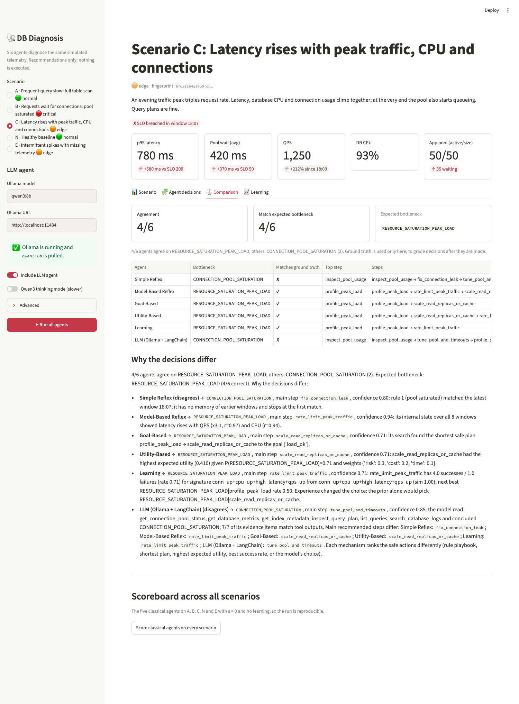

# Database Performance Diagnosis Assistant

Assignment 1, Set 4. Six agents diagnose a slow database-backed application from **simulated**
telemetry (query latency, connection-pool status, query plans, index metadata, database logs) and
recommend **safe** diagnostics or optimizations. Nothing is ever executed: schema changes are
always proposals for review in staging.

| # | Agent | How it decides | Code |
|---|-------|----------------|------|
| 1 | Simple Reflex | Ordered condition → action rules on the latest window only | `dbdiag/agents/simple_reflex.py` |
| 2 | Model-Based Reflex | Rules on an internal state built window by window (trends, persistence, onsets, stale metrics) | `dbdiag/agents/model_based.py` |
| 3 | Goal-Based | Breadth-first search over actions with STRIPS preconditions/effects until the goal state holds | `dbdiag/agents/goal_based.py` |
| 4 | Utility-Based | Ranks every action by expected utility: P(h)-weighted benefit − risk − cost − time | `dbdiag/agents/utility_based.py` |
| 5 | Learning | Evidence match × success rate learned from past outcomes; critic, learning element, ε-exploration | `dbdiag/agents/learning_agent.py` |
| 6 | LLM (Ollama + LangChain) | Local Qwen3 calls read-only tools in a loop; evidence verified against tool outputs | `dbdiag/agents/llm_agent.py` |

Every agent returns the same structure (`dbdiag/models.py::AgentDecision`): **symptom summary,
evidence, likely bottleneck, recommended steps, verification metric**, plus confidence, a reasoning
trace and agent-specific extras.

## Architecture

```
data/scenarios/*.json ──► scenarios.load_scenario ──► Scenario (frozen, pydantic)
                                                         │ agent_view(): ground truth removed
                                                         ▼
                     ┌────────────── runner.run_all_agents (same object to all) ──────────────┐
                     │                                                                         │
   tools.py (read-only helpers) ──► perception.py ──► Percept(s) ──► 5 classical agents        │
          │                                                                                    │
          └──► LangChain @tool wrappers (make_tools) ──► ChatOllama(qwen3) tool loop ──► LLM    │
                     │                                                                         │
                     └─► AgentDecision ×6 ─► safety.assert_safe ─► fingerprint check ──────────┘
                                                         │
                                 comparison.py (table, agreement, why they differ)
                                                         │
                               app.py (Streamlit)  ·  scripts/run_scenarios.py (results/)
```

Shared knowledge (`dbdiag/knowledge.py`): generic thresholds, the catalogue of safe actions (each
with benefit per bottleneck, risk, cost, time-to-effect, preconditions and effects), goal facts and
verification metrics. All agents draw their recommendations from that one catalogue.

## Setup

```bash
python3 -m venv .venv && source .venv/bin/activate
pip install -r requirements.txt

# LLM agent (local model)
brew install ollama            # or the macOS app from ollama.com
ollama serve                   # in another terminal
ollama pull qwen3:8b           # use qwen3:4b on machines with less RAM
```

## Run

```bash
streamlit run app.py                     # UI
python scripts/run_scenarios.py          # all agents on all scenarios -> results/
python scripts/run_scenarios.py --no-llm --pytest   # classical only, plus results/pytest_report.txt
pytest                                   # test suite (LLM mocked, no Ollama needed)
pytest -m ollama                         # real Qwen3 on scenarios A, B, C
```

If Ollama is not running, the LLM agent reports a clear error (in the UI and in `results/`)
and **does not produce a substitute answer**; the five classical agents still run.

## Scenarios

| ID | Category | What is happening | Expected bottleneck |
|----|----------|-------------------|---------------------|
| A | normal | Q1 runs 3000×/min as a Seq Scan over 2.4M rows to return 3; no index on `customer_email` | `MISSING_INDEX_FULL_SCAN` |
| B | critical | Pool 50/50 active, up to 167 waiting, 2–4 s waits, timeouts, leak and idle-in-transaction logs; DB CPU ~23% | `CONNECTION_POOL_SATURATION` |
| C | edge | QPS ×3.1; p95, CPU (93%) and connections climb together; the pool queues only in the last 3 windows | `RESOURCE_SATURATION_PEAK_LOAD` |
| N | normal | Every metric inside the SLO; a Seq Scan on a 48-row table is a false lead | `HEALTHY` |
| E | edge | p99 spikes, CPU missing in 4/6 windows, 1500× planner estimate error (stale statistics), lock-wait timeouts | `AMBIGUOUS` (gather more data, lower confidence) |

**Fairness.** The runner converts the scenario to its agent view once and hands the *same frozen
object* to all six agents. Each decision records the scenario's SHA-256 fingerprint (canonical
JSON without ground truth) and the runner rejects any mismatch; the UI shows the check. Agents
never see `ground_truth`: `BaseAgent.make_decision` refuses a scenario that still has it. Ground
truth is read only by the tests, the comparison (to grade finished decisions) and the learning
agent's critic (after deciding). The LLM is not shown the scenario title or description because
they name the answer; it sees only what its tools return.

## Agent mechanisms

**Simple Reflex.** Percept = the latest window only. Rules, first match wins: (1) pool full with
requests waiting → pool saturation; (2) frequent large Seq Scan → missing index; (3) CPU ≥ 85% →
peak load; (4) lock waits → lock contention; (5) no problem symptoms → healthy; (6) otherwise
ambiguous. The trace lists every rule checked and the values that made one fire.

**Model-Based Reflex.** `update_state(state, percept)` folds each window into a `WorldState`:
QPS/p95/CPU/connection series, per-symptom counts, streaks and first-seen windows, last known CPU
with a staleness counter, running log-category counts. World-model rules then interpret the state:
latency correlated with rising QPS (r ≥ 0.8, QPS ≥ ×1.5) means load; pool saturation that *starts
after* latency breached is a consequence of load, not the cause; persistent pool waits with low
CPU mean a pool/leak problem; a persistent large Seq Scan with flat QPS means the plan. Two or
more competing explanations → `AMBIGUOUS`; missing telemetry lowers confidence.

**Goal-Based.** Belief state from weighted evidence (`agents/hypotheses.py`). If one hypothesis
dominates (P ≥ 0.5 and ≥ 1.5× the runner-up), the goal is that bottleneck's goal facts (e.g.
`plan_fixed`, `pool_ok`); otherwise the goal is to reduce uncertainty (`telemetry_complete`,
`locks_diagnosed`, `stats_checked`). BFS (depth ≤ 5) over the catalogue's STRIPS actions finds the
shortest safe plan; optimizations require facts only diagnostics produce, so a change always comes
after the diagnostic that confirms it. Example (A): `explain_analyze_in_staging` →
`review_index_proposal`, 8 nodes expanded.

**Utility-Based.** `EU(a) = Σ_h P(h)·benefit(a,h) − w_risk·risk − w_cost·cost − w_time·time`,
default weights risk 0.3, cost 0.2, time 0.1 (sliders in the UI). The best action is preceded by
the diagnostics its preconditions need and followed by the next best action. On E no hypothesis
dominates, so cheap diagnostics win (`analyze_stats_in_staging` EU 0.265 beats every fix). Changing
the weights changes the choice: with `w_cost = 1.0`, C switches from replicas to rate limiting.

**Learning.** *Performance element:* a symptom signature from the window sequence (e.g.
`full_scan+high_latency`); each option `BOTTLENECK|action` scores `evidence_match × success_rate`,
`success_rate = (s+1)/(s+f+2)`, with counts from the exact signature plus similar ones (Jaccard ≥
0.5, similarity-weighted). *Critic:* ground truth (simulated) or 👍/👎 in the UI. *Learning element:*
updates `data/experience.json` and a history log. *Problem generator:* with probability ε (0.1 in
the UI, 0 in tests and batch runs) it explores the second-best option. Example trace on A:

> review_index_proposal has 8.3 successes / 1.0 failures (rate 0.82) for signature
> full_scan+high_latency from full_scan+high_latency (sim 1.00), full_scan+high_latency+qps_up
> (sim 0.67); next best MISSING_INDEX_FULL_SCAN|explain_analyze_in_staging rate 0.75.

On C, experience *changes* the choice: the prior alone would pick `scale_read_replicas_or_cache`
(highest benefit), but past outcomes (4/1 vs 1/2) make it pick `rate_limit_peak_traffic`.
`data/experience_seed.json` is committed; `data/experience.json` (gitignored) is created from it
and can be reset from the UI.

**LLM.** `make_tools(scenario)` wraps the six read-only functions in `dbdiag/tools.py`
(`get_database_metrics`, `get_connection_pool_status`, `list_queries`, `inspect_query_plan`,
`search_database_logs`, `get_index_metadata`) as LangChain tools closed over the frozen scenario.
`ChatOllama(model="qwen3:8b", temperature=0).bind_tools(tools)` runs in a manual loop (≤ 8 turns)
that records every call's arguments, result and latency. Before an answer is accepted the model must
have used ≥ 2 distinct tools **and** looked at each evidence group (system metrics, query plans or
indexes, logs); otherwise it is re-prompted (up to 2 times) with the groups it skipped, and a
decision with fewer than 2 tools is marked `grounded=False` with confidence halved. The answer is
validated against a schema (`LLMAnswer`); if it drifts (real runs showed qwen3 inventing keys such
as `diagnosis`/`recommendations`), one repair retry uses Ollama's schema-constrained output. Every
number and identifier in its evidence is checked against the tool outputs (✅ / ⚠️ in the UI,
`grounding_score` = verified fraction), and confidence is scaled by it. Unsafe recommendations are
removed, and changes are reordered after the diagnostics they need, before the shared safety guard
runs. Qwen3's thinking mode is off by default (`--think` / UI toggle turns it on: better reasoning,
several times slower).

Sample tool-call trace (scenario A, `qwen3:8b`, from `results/decisions.json`):

```
1. get_database_metrics({"window": "all"})                           1.30 ms
2. get_connection_pool_status({"window": "all"})                     0.29 ms
3. list_queries({})                                                  4.83 ms
4. search_database_logs({"level": "WARNING", "pattern": ".*"})      3.63 ms
5. inspect_query_plan({"query_id": "Q1"})                            2.78 ms
6. get_index_metadata({"table": "orders"})                           2.18 ms

Evidence check (grounding score 1.00, grounded=True):
✅ Query Q1 has a Seq Scan on the 'orders' table with a mean latency of 850 ms
✅ The 'orders' table has 2,400,000 rows and was last analyzed on 2026-11-08
✅ The 'orders' table has an index 'orders_pkey' on the 'id' column and an index
   'orders_created_at_idx' on the 'created_at' column
✅ The query plan for Q1 shows a full scan with an estimate error ratio of 1.3 and rows
   examined per row returned of 800,000.0
✅ The 'customer_email' column is not indexed, leading to a full scan

Decision: MISSING_INDEX_FULL_SCAN (confidence 0.95)
Steps: explain_analyze_in_staging → review_index_proposal → analyze_stats_in_staging
```

The screenshot `docs/screenshots/A_3_llm_tool_trace.png` shows the same trace with the raw
`inspect_query_plan` and `get_index_metadata` outputs expanded.

## Results

Generated by `python scripts/run_scenarios.py` (full per-scenario tables, evidence and traces in
`results/comparison_<ID>.md`, all decisions in `results/decisions.json`):

| Agent | A | B | C | N | E | Bottleneck correct |
| --- | --- | --- | --- | --- | --- | --- |
| Simple Reflex | ✔ MISSING_INDEX (0.80) | ✔ POOL (0.80) | ✘ POOL (0.80) | ✔ HEALTHY (0.90) | ✘ LOCK (0.70) | 3/5 |
| Model-Based Reflex | ✔ (0.95) | ✔ (0.95) | ✔ PEAK_LOAD (0.94) | ✔ (0.90) | ✔ AMBIGUOUS (0.28) | 5/5 |
| Goal-Based | ✔ (0.94) | ✔ (0.95) | ✔ PEAK_LOAD (0.71) | ✔ (0.91) | ✔ AMBIGUOUS (0.41) | 5/5 |
| Utility-Based | ✔ (0.94) | ✔ (0.95) | ✔ PEAK_LOAD (0.71) | ✔ (0.91) | ✔ AMBIGUOUS (0.41) | 5/5 |
| Learning | ✔ (0.82) | ✔ (0.75) | ✔ PEAK_LOAD (0.71) | ✔ (0.88) | ✔ AMBIGUOUS (0.77) | 5/5 |
| LLM (qwen3:8b) | ✔ (0.95) | ✔ (0.88) | ✘ POOL (0.85) | ✔ (0.93) | ✔ AMBIGUOUS (0.70) | 4/5 |

LLM grounding scores (share of evidence items whose values match tool outputs): A 1.00, B 0.86,
C 1.00, N 0.86, E 1.00. Each LLM run takes about 1–2 minutes per scenario on a 16 GB laptop;
temperature 0 makes repeated runs give the same answers.

### Why decisions differ

- **A (normal).** All agents agree on the missing index: the evidence is strong and consistent in
  every window. They differ in confidence (rules use fixed confidences; the others derive it from
  evidence or success rates) and in how many steps they recommend.
- **B (critical).** All agents agree on pool saturation. The Goal-Based agent stops at the shortest
  plan (`inspect_pool_usage` → `fix_connection_leak`); the Utility and reflex agents also list
  `tune_pool_and_timeouts` as a follow-up; the Learning agent picks the leak fix because it has the
  best success rate (5/1).
- **C (edge).** Simple Reflex is wrong by design: in the last window (18:07) the pool is full with
  35 waiting, so rule 1 fires, and it has no memory of the earlier windows where latency rose with
  QPS long before the pool queued. Model-Based sees latency track QPS (r = 0.97, ×3.1) and that pool
  saturation started *after* the latency breach, so it treats the pool as a consequence. Goal and
  Utility reach the same diagnosis from weighted evidence (P = 0.71); Utility prefers replicas
  (higher benefit), Learning prefers rate limiting (better track record). The LLM makes the same
  mistake as Simple Reflex: it reads the full pool and timeouts and calls it pool saturation,
  without weighing that QPS tripled and CPU reached 93% first. A trend across windows is exactly
  what neither a single-window rule nor an 8B model reading JSON picks up reliably.
- **N (healthy).** All classical agents recommend `continue_monitoring`; none is misled by the cheap
  Seq Scan on the 48-row `app_settings` table, because the shared thresholds only flag large,
  frequent scans. The LLM also says `HEALTHY`, but still suggests reviewing an index for that scan:
  its diagnosis and its steps are not consistent with each other.
- **E (ambiguous edge).** Simple Reflex sees lock waits in the last window and fires rule 4
  (`LOCK_CONTENTION`, 0.70) without noticing the stale statistics or the missing CPU. The other
  agents report `AMBIGUOUS` and recommend diagnostics only: Model-Based finds two competing
  explanations plus 4 windows of missing CPU (confidence 0.28); Goal-Based can't set a fix goal and
  plans `collect_missing_telemetry` → `check_locks` → `analyze_stats_in_staging`; Utility finds that
  cheap diagnostics have the highest EU; Learning matches a similar past incident (similarity 0.75)
  in which `check_locks` worked 3/3, so its confidence (0.77) reflects that history, not certainty
  about the cause. The LLM also reports `AMBIGUOUS` (0.70) and lists diagnostics first, but ends
  with `review_index_proposal`, a change the classical agents hold back until a cause is confirmed.

## Safety

The assistant recommends; it never executes. Tools only read the in-memory scenario. Every
decision passes `safety.assert_safe`, which rejects destructive statements (DROP, TRUNCATE, DELETE
FROM, UPDATE … SET, GRANT, …) and allows schema or maintenance changes (CREATE INDEX, ALTER, ANALYZE,
…) only when phrased as a proposal for review or staging and never as "run it in production". The
Goal-Based search only uses actions that pass the guard; the LLM's unsafe suggestions are removed
and listed in the UI.

## Testing

`pytest` runs 242 tests (`results/pytest_report.txt`): scenario schema and fingerprints, perception,
tools, safety, the classical agents (agents × scenarios; diagnostics before changes; mechanism
checks such as the BFS plan, utility weights and model-based state), the learning agent (counts
update and persist, history flips the ranking, ε = 0 determinism, reset), the LLM agent with a
scripted fake chat model (tool loop, ≥ 2-tool and evidence-group re-prompts, schema repair,
grounding, diagnostics-first reordering, unsafe removal, Ollama-down error), runner fairness, and
headless Streamlit smoke tests (`streamlit.testing.AppTest`: every scenario renders all four tabs,
feedback updates and resets the experience, the scoreboard covers every scenario).
`pytest -m ollama` runs the real model on A, B and C and asserts ≥ 2 distinct tools and grounding ≥ 0.7.

## Limitations

- Simulated data only; there is no real database connection.
- Thresholds and evidence weights are hand-set (generic, not per scenario), and five scenarios are
  a small test set.
- The LLM can be non-deterministic, and small models skip tools, drift from the output format or
  misread evidence. Re-prompts and schema repair fix the first two; nothing fixes the third.
- **Grounding checks values, not reasoning.** An item passes when its numbers and identifiers appear
  in the tool outputs or the prompt, even if the conclusion drawn from them is wrong (e.g. "estimate
  error 1.2, indicating stale statistics": 1.2 is real, stale statistics would need ~100×). Vague
  items with no concrete value count as unverified. Number matching is tolerant (±1%, ratios as
  percentages), so a coincidental match can count as verified.
- The LLM's prompt was first worded "users report the application is slow"; on the healthy scenario
  N the model then invented an SLO breach. The prompt is now neutral ("HEALTHY is a valid answer"),
  the same information the classical agents get.
- The learning agent's critic uses simulated ground truth; its seed history is invented, and
  signatures are coarse, so different incidents can share one.
- The Goal-Based and Utility-Based agents share one evidence model, so they usually agree on the
  bottleneck; they differ in how they choose and order actions.

## Screenshots

Captured from the running app (`streamlit run app.py`) with real `qwen3:8b` runs, in
`docs/screenshots/`. Each scenario has four: telemetry (`_0_scenario`), the six decision cards
(`_1_agent_decisions`), the comparison table with "why the decisions differ" (`_2_comparison`), and
the LLM's tool-call trace with ✅/⚠️ evidence checks (`_3_llm_tool_trace`).

| Scenario | Scenario | Agent decisions | Comparison | LLM tool trace |
| --- | --- | --- | --- | --- |
| A (normal) | [A_0](docs/screenshots/A_0_scenario.png) | [A_1](docs/screenshots/A_1_agent_decisions.png) | [A_2](docs/screenshots/A_2_comparison.png) | [A_3](docs/screenshots/A_3_llm_tool_trace.png) |
| B (critical) | [B_0](docs/screenshots/B_0_scenario.png) | [B_1](docs/screenshots/B_1_agent_decisions.png) | [B_2](docs/screenshots/B_2_comparison.png) | [B_3](docs/screenshots/B_3_llm_tool_trace.png) |
| C (edge) | [C_0](docs/screenshots/C_0_scenario.png) | [C_1](docs/screenshots/C_1_agent_decisions.png) | [C_2](docs/screenshots/C_2_comparison.png) | [C_3](docs/screenshots/C_3_llm_tool_trace.png) |
| E (ambiguous edge) | [E_0](docs/screenshots/E_0_scenario.png) | [E_1](docs/screenshots/E_1_agent_decisions.png) | [E_2](docs/screenshots/E_2_comparison.png) | [E_3](docs/screenshots/E_3_llm_tool_trace.png) |

Learning tab on scenario A, starting from the seed experience:
[before feedback](docs/screenshots/learning_1_before_feedback.png) and
[after the simulated critic](docs/screenshots/learning_2_after_feedback.png)
(`review_index_proposal` for `full_scan+high_latency`: 7 → 8 successes, rate 0.800 → 0.818,
one history entry). `A_3` was taken after that feedback, which is why its Learning card shows 0.84
rather than the 0.82 in `A_1`.



## Team

Group 15 (Assignment 1, Set 4)

| Member | Contribution |
|--------|--------------|
| Venkatakrishna Bhat K | Shared core (models, scenarios, tools, perception, safety), agents, UI |
| MOPURI NAGARAJU | First version of the six agents |
| D ASRITHA | Streamlit UI (front end) and UI smoke tests |
| SUNEIIL SINGHH | Testing and report |
